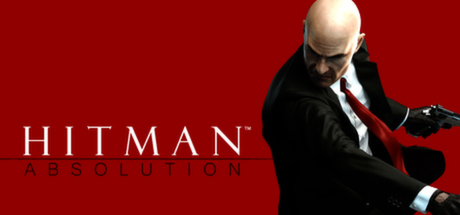

**Hitman: Absolution is the more story-driven and linear chapter of the Hitman franchise, following a betrayed Agent 47 protecting a girl from the ICA. Features the unique Instinct system for disguise management and the Contracts mode for user-created challenges.**

---

## 📖 About

Hitman: Absolution is the more story-driven and linear chapter of the Hitman franchise, following a betrayed Agent 47 protecting a girl from the ICA. Features the unique Instinct system for disguise management and the Contracts mode for user-created challenges.

## ⚠️ Problems Without Trainer

| Problem | Status |
|---------|--------|
| **Linear Level Design** — Much more corridor-focused than the sandbox World of Assassination | ✅ Solved |
| **Disguise Decay** — Instinct management for disguise effectiveness depletes frustratingly fast | ✅ Solved |
| **Checkpoint System** — Inconsistent checkpoint placement creates long re-run sections | ✅ Solved |
| **Story Mode Shift** — Longtime fans disliked the narrative-driven departure from open sandbox | ✅ Solved |

## ✅ Solution

The **Hitman: Absolution Trainer** solves all these issues by giving you complete control over the game.

## 🎯 Full Feature List

- Unlimited Resources
- God Mode / Invincibility
- Instant Skill Cooldown
- One-Hit Kill
- Freeze Game Timer
- Unlock All Items & Achievements
- Custom Speed Multiplier
- Save State Anywhere

## 🚀 Quick Start

1. **Disable Windows Defender** temporarily (trainer may trigger false positive)
2. Download the trainer from the button above
3. Launch Hitman: Absolution
4. Run the trainer as Administrator
5. Activate desired cheats with hotkeys

## 💎 Free vs Paid

| Feature | Free | Pro |
|---------|------|-----|
| Basic God Mode | ✅ | ✅ |
| Unlimited Resources | ✅ | ✅ |
| All Advanced Cheats | ❌ | ✅ |
| Auto-Updates | ❌ | ✅ |
| Priority Support | ❌ | ✅ |

## 💻 Requirements

- Windows 10/11 (64-bit)
- Hitman: Absolution (any version)
- .NET Framework 4.8+
- DirectX 11+

## 🍎 macOS

macOS users can use our alternative tool:

## ⚖️ Legal

This trainer is for educational and single-player use only. Use responsibly.

---

